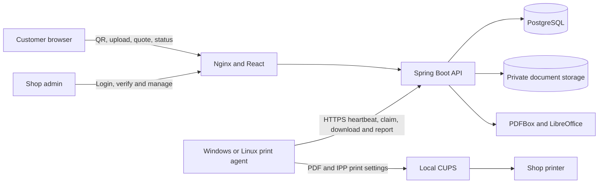

# SmartPrint

SmartPrint is a QR-based self-service printing platform for multiple shops. A customer opens a shop's QR link, uploads documents, checks a server-priced preview, and submits a cash or mobile-wallet payment reference. The shop verifies the payment. A local CUPS agent then prints the approved order and reports its result.

## Architecture and stack

| Layer | Implementation |
| --- | --- |
| Customer and admin | React, TypeScript, Vite, React Router and responsive CSS, served by Nginx |
| API and authentication | Java 21, Spring Boot, Spring Security, BCrypt password hashes and signed admin JWTs |
| Data | PostgreSQL 16, Spring Data JPA and Flyway migrations |
| Documents | Private S3-compatible storage, PDFBox for PDFs and previews, LibreOffice for DOC and DOCX |
| Live updates | Server-Sent Events for customer status and automatic polling for reconnect and queue position. The admin workspace refreshes operational data every five seconds. |
| Local printing | Python with the Windows Print Spooler or Linux CUPS, plus an SQLite submission journal |



Admin JWT claims identify the shop. Admin queries scope orders, queues, payments and printers to it. Agent credentials are hashed and scoped to a single shop and agent. Each customer order has an independent random tracking token. Treat its URL as private because it grants access to that order. Regenerating a shop QR invalidates older shop links. Existing order tracking links continue to work.

Orders take one set of print options for all files. The quote uses the actual PDF page count after conversion. The charge is selected pages × the color or monochrome per-page price × copies × the sides rate, rounded to two decimals per file. A duplex rate of 100% charges the base rate. The order stores the amount confirmed at submission. If the amount changes between quote and submit, the API returns a conflict before creating the order.

## Database schema

The SQL files in [db/migration](backend/src/main/resources/db/migration/) define the schema and upgrade path.

| Table | Key relationships and data |
| --- | --- |
| `shops`, `shop_settings` | Stable shop ID, unique code and rotatable QR token. Per-shop prices, feature switches, wallet numbers, retention, queue pause and printer routing. |
| `users`, `roles` | Shop-scoped admin records with globally unique usernames and BCrypt hashes. |
| `orders` | Shop ID, unique order number and public token, status, amount, currency and purge deadline. Optional per-shop submission key makes the same checkout request safely retryable. |
| `order_files`, `print_configs` | Order-owned private object keys, detected MIME type, PDF page count, selected pages, copies, sides, orientation and color. |
| `payments` | Order payment, provider, transaction ID, amount, review timestamp and rejection reason. A unique provider/reference index prevents reuse. |
| `queue_counters`, `print_queue_entries` | Daily serial counter and one queue entry per order. A separate priority orders waiting jobs across days. Reordering preserves the customer's daily serial. |
| `print_agents`, `printers`, `print_jobs` | Tenant-scoped agent credentials, reported printer capabilities, assignments, per-file attempts, completion and failure records. |
| `customer_sessions`, `printer_capabilities` | Tables retained from the starter schema. The current customer workflow uses order tokens, and printer discovery stores basic capabilities on `printers`. |

A shop row lock serializes queue mutations and agent claims. Only a verified payment allocates a queue entry. Orders can print in parallel on separate printers. A reservation prevents concurrent requests from assigning one printer or a known alias to different orders. If paused, a shop can still accept orders and existing assignments can finish. Queue cancellation applies to waiting jobs.

## API endpoints

The paths below are relative to `/api/v1`. Swagger is available at `http://localhost:8080/swagger-ui.html` in local development.

| Audience | Method and path | Purpose |
| --- | --- | --- |
| Shop owner | `POST /auth/register-shop`, `POST /auth/login`, `GET /auth/me` | Register, sign in, load admin identity |
| Customer | `GET /public/shops/{qrToken}`, `GET /public/shops/{qrToken}/qr.png` | Shop details and QR image |
| Customer | `POST /public/shops/{qrToken}/quote` | Multipart quote, page counts and selection validation |
| Customer | `POST /public/shops/{qrToken}/preview` | Multipart draft JPEG for any selected page of a file |
| Customer | `POST /public/shops/{qrToken}/orders` | Submit multipart files and settings, payment and optional transaction ID, expected amount and request key |
| Customer | `GET /public/orders/{publicToken}`, `GET /public/orders/{publicToken}/events` | Order state and live notifications |
| Customer | `GET /public/orders/{publicToken}/files/{fileId}/preview.pdf`, `POST /public/orders/{publicToken}/payments/reference` | Printable PDF and transaction reference for an existing order |
| Admin | `GET /admin/dashboard`, `GET /admin/orders`, `GET /admin/orders/{orderNumber}`, `GET /admin/events` | Metrics, paginated requests and order inspection |
| Admin | `GET /admin/orders/{orderNumber}/files/{fileId}/preview.pdf` | Protected PDF preview. Print attempts are available at `GET /admin/orders/{orderNumber}/print-attempts`. |
| Admin | `GET /admin/payments/pending`, `POST /admin/payments/{id}/approve`, `POST /admin/payments/{id}/reject` | Payment review |
| Admin | `GET /admin/queue`, `GET /admin/queue/summary`, `POST /admin/queue/pause` | Queue snapshot and pause/resume |
| Admin | `POST /admin/queue/{id}/move`, `POST /admin/queue/{id}/cancel`, `POST /admin/queue/{id}/retry`, `POST /admin/queue/{id}/complete` | Reorder, cancel, retry or record manual completion of a waiting order |
| Admin | `GET/PUT /admin/shop`, `GET /admin/shop/qr.png`, `POST /admin/shop/qr/regenerate`, `GET/PUT /admin/settings` | Profile, QR and shop settings |
| Admin | `GET /admin/printers`, `GET /admin/printers/discovery`, `PATCH /admin/printers/routing`, `PATCH /admin/printers/{id}`, `GET/POST /admin/agents`, `GET /admin/reports/sales` | Printers, credentials and date-range sales |
| Agent | `POST /agent/heartbeat`, `POST /agent/jobs/assignments`, `POST /agent/jobs/next` | Report OS workload and claim or resume assignments. The next endpoint serves one assignment for older clients. |
| Agent | `GET /agent/jobs/{id}/files/{fileId}.pdf`, `POST /agent/jobs/{id}/files/{fileId}/complete` | Assigned file and receipt for its current submission attempt |
| Agent | `POST /agent/jobs/{id}/complete`, `POST /agent/jobs/{id}/failed` | Final result for the assigned order |

Admin calls use `Authorization: Bearer …`. Agent calls use `X-Agent-Code` and `X-Agent-Token`. Each per-file completion also supplies the job payload's `submissionKey` as `X-Submission-Key`.

## Screens

| Route or tab | Contents |
| --- | --- |
| `/` | SmartPrint introduction and shop onboarding |
| `/s/:qrToken` | Shop-specific multi-file upload, enabled print options, preview, price and payment |
| `/orders/:publicToken` | Waiting for review, queue position and serial, printing, ready for pickup, failed, cancelled or rejected with reason |
| `/admin/register`, `/admin/login` | Shop registration and admin sign-in |
| Overview | Today's orders, pending approvals, current queue and confirmed payments |
| Requests | Order history and filters, payment details, document preview, approval, rejection and failed-print retry |
| Queue | Active assignments, waiting jobs, reorder, pause/resume and cancel |
| Settings | File and print option availability, prices, payments and retention |
| Printers | Agent enrollment, all discovered printers, OS availability, pending and active jobs, model and manual routing |
| Reports | Orders, completions, cancellations and confirmed payments across the selected shop-local dates |
| Shop QR | Open the customer page, download the PNG or regenerate the QR |

## Print agent

Install the agent on the shop PC. On Windows it reads installed local and connected printer queues and the signed-in user's system default through the Windows Print Spooler. Run the agent as the same Windows user whose **Printers & scanners** settings should control automatic routing. The operating-system default remains visible in the routing form as a reference. The agent flags common virtual queues and groups queues that share a spooler server and port. Queues using different ports can still refer to the same device. Linux installs discover printers and capabilities through CUPS. Open **Printers** to see the active agent and detected printer. The browser checks the local agent on loopback and confirms that its credentials have a recent heartbeat for the current shop. When local discovery is unavailable, it uses the active agent behind a saved default route or an active shop agent with printers. The agent reports its operating-system default and the page fills unset routing fields from that device. Select a specific queue and click **Save Printer Routing** to pin it. Use **Automatic load balancing** for Default Printer and **Use default routing** for color and monochrome to enable the printer pool. Saved routes stay in force and wait for their printer to become free and compatible. Automatic dispatch excludes virtual, offline, paused, busy and errored queues. It chooses the compatible free queue with the fewest pending jobs, then the least recently assigned queue. The dispatcher can skip a waiting order whose compatible printers are unavailable and route a later order to a free printer. All agents must be upgraded to report workload and availability before they receive new assignments.

The agent uses the server-rendered PDF, so page selection and orientation are already applied. It submits one file at a time per assignment with copies, color and duplex options, and tracks multiple independent spool jobs between heartbeats. The SQLite journal records the submission key before sending the file to CUPS and records the CUPS job ID after submission. A restart resumes monitoring the same spool job. If CUPS accepted a job just before the agent stopped, the agent looks up its unique spool title. When it cannot determine the result, it reports a failure for staff review. Before retrying an uncertain result, inspect the printer output and CUPS queue. The server skips files already marked complete on a retry.

CUPS reports job completion or cancellation. Completion reflects the spooler and driver's status, which can differ from physical delivery on printers that acknowledge jobs before pages exit. A disconnected agent leaves an active order assigned to that agent until it reconnects with its credentials and state directory. Keep CUPS job history available for interruption recovery. On Windows the agent renders approved PDFs through the configured driver and checks the Windows queue for the printed status. Drivers that remove the job before reporting completion can leave the result uncertain. Check the physical output before retrying.

The default server limits are 20 files, 20 MB each, 100 MB including multipart overhead per request, and 500 PDF pages per file. An image becomes a single PDF page. Source and normalized files are private and deleted by the retention cycle after completion or at the upload deadline. The default retention is 24 hours with a ten-minute scan interval. Object-store lifecycle rules can provide an independent backstop for documents orphaned by a server crash. Configure CUPS to discard spool documents after printing according to the shop's privacy policy.

## Development plan

1. Establish the tenant schema, shop registration, authenticated administration and QR routing.
2. Build the file validation, Word/image conversion, page selection, preview and server pricing pipeline.
3. Add manual payment recording, approval and rejection, and serialize approval-to-queue transitions.
4. Add customer status subscriptions, admin requests, queue controls, printer routing and sales reporting.
5. Build the local agent with capability discovery, protected output download, spool monitoring and repeat-safe acknowledgements.
6. Verify the API flow, document rendering, agent recovery and frontend build, then validate deployment and physical output on each shop's target printer.

## Run locally

Copy `.env.example` to `.env`. Set a fresh `JWT_SECRET` with `openssl rand -hex 32`, and use your own database and object-store passwords. Keep `PUBLIC_BASE_URL=http://localhost:8081` for development on the same computer. For QR scans from phones, set it to the browser-accessible shop server URL and update `CORS_ALLOWED_ORIGINS` to match.

```sh
docker compose up -d --build
```

Open [http://localhost:8081](http://localhost:8081) and choose **Register shop**. Under **Settings**, set prices, enable payment methods and enter wallet numbers. The application records mobile payment references and staff reconcile them against the shop's wallet. No provider API credentials are needed. Open **Shop QR** to download or scan the code.

For split development, start PostgreSQL and the S3-compatible service, configure the variables in [backend/.env.example](backend/.env.example) in your shell and run `mvn -f backend/pom.xml spring-boot:run`. Install LibreOffice Writer on the backend host when running outside its container. Run `npm ci` and `npm run dev` in `frontend/`. Vite serves on port 5173 and proxies the API to port 8080.

### Start the agent

For Windows, open PowerShell in `print-agent` as the intended Windows printer user.

```powershell
py -3 -m venv .venv
.\.venv\Scripts\python.exe -m pip install -r requirements.txt
Copy-Item .env.example .env
```

Fill in the agent credentials and server URL in `.env`, then run `.\.venv\Scripts\python.exe -m app.main`. For automatic startup, run that command from Task Scheduler at the intended user's logon. A Windows service account may have a different default printer.

For Linux, use the following setup.

Install Python 3, CUPS, its development headers and a C compiler on the shop PC so PyCUPS can build. On Debian-based systems the package names include `cups`, `libcups2-dev`, `python3-venv`, `python3-dev` and `build-essential`.

```sh
cd print-agent
python3 -m venv .venv
. .venv/bin/activate
pip install -r requirements.txt
cp .env.example .env
chmod 600 .env
```

Create credentials in **Printers** and enter them in the agent's `.env`. Set `SMARTPRINT_API_BASE` to the application's HTTPS API URL, such as `https://print.example.com/api/v1`. Loopback HTTP is supported for a server running on the same PC. Use a long-running process or the host's service manager to run the following command from `print-agent/` after installation.

```sh
.venv/bin/python -m app.main
```

For same-origin deployment the loopback identity endpoint uses the API origin by default. If the admin page uses a different origin, set `SMARTPRINT_BROWSER_ORIGIN` to the exact browser origin, for example `http://localhost:8081`. The identity endpoint is fixed at `127.0.0.1:18765` and returns the public agent code only. Browsers that restrict loopback access can still use server-side heartbeat discovery. Reuse each installation's existing credentials after restarting or upgrading the agent. Agents are considered disconnected 35 seconds after their last successful heartbeat.

The default CUPS socket is `/run/cups/cups.sock`. Override `CUPS_SOCKET` for a different local socket. Keep a stable private `AGENT_STATE_DIR` per agent. For a test shop, `DRY_RUN=true` exposes a virtual destination that records successful processing without paper. Leave `DRY_RUN=false` for real printers.

### Troubleshoot Windows discovery

Run these from `print-agent` as the same Windows user who sees the printers in Chrome. For the second command, stop the running agent first so the diagnostic can acquire its state lock.

```powershell
.\.venv\Scripts\python.exe -m app.main --discover --debug
.\.venv\Scripts\python.exe -m app.main --check-discovery --debug
```

1. The first command lists real installed queues from the Windows spooler cache. A queue whose detailed lookup fails remains in the list with unknown availability, represented as Error. It cannot receive automatic assignments.
2. The second command sends the inventory to `POST /api/v1/agent/heartbeat` and prints the backend acknowledgement without claiming print jobs. Compare `localQueues` with `heartbeat.printerCount` and verify `heartbeat.shopId` is the admin's shop. The agent log defaults to `%LOCALAPPDATA%\smartprint-agent\agent.log` on Windows.
3. Start the agent normally. In the admin Printers tab, inspect `GET /api/v1/admin/printers/discovery` in browser Network. It should contain the same installed queues under `printers`. A failed loopback `/identity` request affects the local-agent preference. The backend inventory can still load.
4. When the web server runs on a separate machine, set `SMARTPRINT_API_BASE` to the server's reachable HTTPS API URL. For trusted LAN development with the default Compose HTTP port, use the server's private IP, for example `http://192.168.1.20:8081/api/v1`, and explicitly set `SMARTPRINT_ALLOW_LAN_HTTP=true`. Loopback URLs point to the Windows PC itself. Check the shop enrollment and rebuild the backend before restarting the agent if the heartbeat is rejected.

### Verify

```sh
mvn -f backend/pom.xml test
npm --prefix frontend run build
(cd print-agent && .venv/bin/python -m unittest discover -s tests -v)
```

The backend integration suite starts a PostgreSQL 16 instance and an HTTP server with stubbed object storage. It covers onboarding, quoting, preview, tenant isolation, payment gating, dispatch and completion. For the shop's hardware acceptance check, submit one cash test and one mobile reference test, confirm no job prints before approval, verify FIFO and pause/resume, and compare printed pages, size, color and duplex against the preview. Test the production proxy with HTTPS and verify the QR from a phone.

For public deployments, put TLS in front of Nginx, use a private bucket and database, and keep their port mappings private. Keep Nginx SSE buffering disabled and avoid logging customer tracking URLs. Isolate the document converter for internet-facing ingestion and enforce request and resource limits at the ingress. Use a supported S3-compatible image or managed storage for your deployment.
